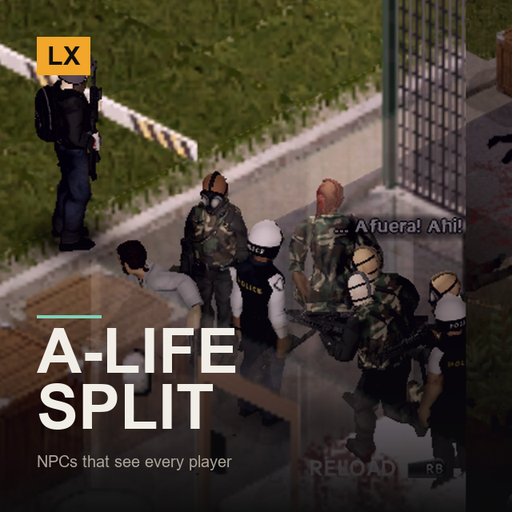

# LX A-Life Split-Screen Fix

**Project A-Life NPCs that see all of you**

> A-Life is built around one player. In split-screen its NPCs only ever noticed player 1. Now they notice everyone.

`Project Zomboid B42.21+` · `v1.1.0` · `CC0`

[English](#english) · [Español](#español) · [Русский](#русский)

---

## English

This mod is part of the **LX Split-Screen Suite**, seven mods that make Project Zomboid B42 playable in 2–4 player couch co-op, with or without a gamepad. Each one stands alone — install only what you need.

### Why split-screen?

Split-screen is the mode that carries the most bugs in stable B42 — and the mods worth playing with, like Bandits and Project A-Life, are built for singleplayer and online multiplayer. Nobody is fixing couch co-op. This suite exists to close that gap: to make split-screen as playable as the modes that get the attention.

### Why gamepad?

B42 keeps improving controller support, but it is still rough, and the aim-and-shoot rework left gunplay on a gamepad close to unusable — you cannot even shoot a zombie lying on the ground. Split-screen *with* a gamepad is the worst case the game offers. These mods give PZ back an aim that was designed for a stick: assist on the vertical axis, B41-style lock-on, per-player aim state, and a lot more.

### What it does

- **NPCs perceive every local player** — A-Life asks the game for “the players” through one locator used by *all* of its AI — perception, spawning and despawning, decision pacing, shelter visitors. Outside online multiplayer that call returns a single player. Now it returns every local player, so the whole AI stack sees all of you.
- **Encounters, raids and world events reach everyone** — Encounters could only revolve around player 1 and were discarded when the chosen player was someone else. Road encounters while driving watched one player. Raids, world events and base heat looked at player 1 only. All of them now pick from whoever is actually around.
- **Player 2's emotes are player 2's** — Surrendering, waving, asking NPCs to stand down, insulting — everything you “say” through gestures was delivered as if player 1 did it. Now it is credited to whoever did it. Same for helping an NPC by killing a zombie.
- **The talk window opens where you are** — With two or more players the conversation window opens in the speaking player's half of the screen, and falls back to the classic layout when the cinematic one is wider than that half.
- **Reputation tab no longer traps the controller** — The Reputation tab in the character info screen did not respond to a gamepad and left it stuck. LB/RB now change tabs and B closes, like every vanilla tab. False “reputation changed” popups caused by two players' data arriving interleaved are gone too.
- **NPC aim resets between targets** — An NPC's aim ramp kept its value when it switched from player 1 to player 2, because both shared one key. Each player now gets their own.

### Requirements

| Mod | Workshop | |
|---|---|---|
| Project A-Life NPCs | [3803984183](https://steamcommunity.com/sharedfiles/filedetails/?id=3803984183) | required |
| A-Life: Knox Fractured | [3813871509](https://steamcommunity.com/sharedfiles/filedetails/?id=3813871509) | optional |

**Load order:** load this **after** `ProjectALifeNPCs`, `ALifeKnoxFractured`. `mod.info` already declares it.

### Installing

**From the Steam Workshop (recommended)**
Subscribe on the Workshop page. Steam downloads it; then start Project Zomboid, go to
**Mods** in the main menu and enable it. In split-screen, enabling it once covers all players.

**Manually**
1. Download this repository (green **Code** button -> **Download ZIP**) and unzip it.
2. Copy the folder `LX_ALifeSplit` into your Zomboid mods folder:
   - Windows: `C:\Users\<you>\Zomboid\mods\`
   - Linux: `~/Zomboid/mods/`
   - macOS: `~/Library/Application Support/Zomboid/mods/`
   The result must be `...\Zomboid\mods\LX_ALifeSplit\42\mod.info`.
3. Start the game, open **Mods** in the main menu and enable **LX A-Life Split-Screen Fix**.

### Notes

- **Nothing is installed inside A-Life's folders.** A-Life marks as incompatible any mod that drops Lua files in there; this one only hooks functions at load time.
- Every hook is applied inside a guard and reported in `console.txt`. If A-Life changes in an update and a hook no longer fits, that hook is skipped and A-Life keeps behaving exactly as it always did.
- Only active outside online multiplayer. In MP, A-Life runs untouched.
- Must load **after** Project A-Life. `loadModAfter` already declares this.

### License

**CC0 1.0 Universal** — public domain dedication. Do whatever you want with it: copy it, change it, put it in a modpack, publish it, sell it. No permission needed, no credit required (though it is always welcome). See `LICENSE`.

### Support

If these mods made your co-op run work, you can buy me a coffee — [ko-fi.com/litoxperaloca](https://ko-fi.com/litoxperaloca)

### The rest of the suite

- [LX Coop Fixes](https://github.com/litoxperaloca/LX_CoopFixes) — Split-screen stability: vehicle crash, player 2 aiming, map stutter, error spam.
- [LX Split Aim](https://github.com/litoxperaloca/LX_SplitAim) — Controller aim assist and B41-style lock-on, per local player.
- [LX Split-Screen Quick Build](https://github.com/litoxperaloca/LX_SPLITSCREEN_CONTEXTMENU_BUILDING) — B41-style build menu in the context menu, because B42's window does not fit.
- [LX Bandits Split-Screen Fix](https://github.com/litoxperaloca/LX_BanditsSplit) — Bandits target the right player, companions follow who recruited them.
- [LX Split-Screen Welcome Package](https://github.com/litoxperaloca/LX_SPLITSCREEN_WELCOME_PACKAGE) — A configurable starter kit per local character.
- [LX Split-Screen Skills Boost](https://github.com/litoxperaloca/LX_SPLITSCREEN_SKILLS_IMPROVE) — A configurable skill floor per local character.
- [LX Theodore Split-Screen Fix](https://github.com/litoxperaloca/LX_TheodoreSplit) — Theodore, the family NPC, reacts to every local player and works with a gamepad.

---

## Español

> A-Life está pensado alrededor de un jugador. En pantalla dividida sus NPCs solo veían al jugador 1. Ahora los ven a todos.

Este mod es parte de la **LX Split-Screen Suite**, siete mods que hacen jugable Project Zomboid B42 en coop de sillón de 2 a 4 jugadores, con o sin mando. Cada uno funciona por separado — instalá solo lo que precises.

### ¿Por qué pantalla dividida?

Es la modalidad con más bugs en la B42 estable — y los mods que valen la pena, como Bandits y Project A-Life, están pensados para un jugador y multijugador online. Nadie arregla el coop de sillón. Esta suite existe para cerrar esa brecha: dejar la pantalla dividida a la par de las modalidades que sí reciben atención.

### ¿Por qué mando?

La B42 viene mejorando el soporte de mando, pero todavía deja mucho que desear, y el rework de apuntado y disparo dejó el tiroteo con mando casi imposible — ni siquiera podés dispararle a un zombi en el suelo. Pantalla dividida *con* mando es el peor escenario posible del juego. Estos mods le devuelven a PZ un apuntado pensado para stick: asistencia en el eje vertical, fijado de blanco estilo B41, estado de apuntado por jugador, y bastante más.

### Qué hace

- **Los NPCs perciben a todos los jugadores locales** — A-Life le pide al juego “los jugadores” a través de un localizador que usa *toda* su IA — percepción, aparición y desaparición de NPCs, ritmo de decisiones, visitantes de refugio. Fuera del multijugador online esa llamada devuelve un solo jugador. Ahora devuelve todos los jugadores locales, así que toda la IA los ve.
- **Encuentros, incursiones y eventos llegan a todos** — Los encuentros solo podían girar alrededor del jugador 1 y se descartaban si el elegido era otro. Los encuentros en la ruta al manejar miraban a un solo jugador. Las incursiones, los eventos del mundo y el “calor” de base miraban solo al jugador 1. Ahora todos eligen entre quienes estén realmente cerca.
- **Los gestos del jugador 2 son del jugador 2** — Rendirse, saludar, pedirle a los NPCs que paren, insultar — todo lo que “decís” con gestos se entregaba como si lo hubiera hecho el jugador 1. Ahora se le acredita a quien lo hizo. Lo mismo al ayudar a un NPC matando un zombi.
- **La ventana de charla se abre donde estás** — Con dos o más jugadores la ventana de conversación se abre en la mitad de pantalla de quien habla, y usa la versión clásica cuando la cinematográfica es más ancha que esa mitad.
- **La pestaña Reputación ya no traba el mando** — La pestaña Reputación de la info del personaje no respondía al mando y lo dejaba trabado. Ahora LB/RB cambian de pestaña y B cierra, como en todas las pestañas del juego. También desaparecen los avisos falsos de “cambio de reputación” que causaba la llegada alternada de los datos de ambos jugadores.
- **La puntería de los NPCs se reinicia entre blancos** — La rampa de puntería de un NPC conservaba su valor al cambiar del jugador 1 al 2, porque ambos compartían una clave. Ahora cada jugador tiene la suya.

### Requisitos

| Mod | Workshop | |
|---|---|---|
| Project A-Life NPCs | [3803984183](https://steamcommunity.com/sharedfiles/filedetails/?id=3803984183) | obligatorio |
| A-Life: Knox Fractured | [3813871509](https://steamcommunity.com/sharedfiles/filedetails/?id=3813871509) | opcional |

**Orden de carga:** cargá este **después** de `ProjectALifeNPCs`, `ALifeKnoxFractured`. El `mod.info` ya lo declara.

### Instalación

**Desde el Steam Workshop (recomendado)**
Suscribite en la página del Workshop. Steam lo descarga solo; después abrí Project Zomboid,
andá a **Mods** en el menú principal y activalo. En pantalla dividida, con activarlo una vez
alcanza para todos los jugadores.

**A mano**
1. Descargá este repositorio (botón verde **Code** -> **Download ZIP**) y descomprimilo.
2. Copiá la carpeta `LX_ALifeSplit` a tu carpeta de mods de Zomboid:
   - Windows: `C:\Users\<vos>\Zomboid\mods\`
   - Linux: `~/Zomboid/mods/`
   - macOS: `~/Library/Application Support/Zomboid/mods/`
   Tiene que quedar `...\Zomboid\mods\LX_ALifeSplit\42\mod.info`.
3. Abrí el juego, entrá a **Mods** en el menú principal y activá **LX A-Life Split-Screen Fix**.

### Notas

- **No se instala nada dentro de las carpetas de A-Life.** A-Life marca como incompatible a cualquier mod que ponga archivos Lua ahí; este solo engancha funciones al cargar.
- Cada enganche se aplica dentro de una guarda y se reporta en `console.txt`. Si A-Life cambia en una actualización y un enganche deja de encajar, ese enganche se omite y A-Life sigue comportándose como siempre.
- Solo se activa fuera del multijugador online. En MP, A-Life corre intacto.
- Debe cargar **después** de Project A-Life. El `loadModAfter` ya lo declara.

### Licencia

**CC0 1.0 Universal** — dedicado al dominio público. Hacé lo que quieras: copialo, cambialo, metélo en un modpack, publicalo, vendelo. No hace falta permiso ni crédito (aunque siempre se agradece). Ver `LICENSE`.

### Apoyar

Si estos mods te arreglaron el coop, podés invitarme un café — [ko-fi.com/litoxperaloca](https://ko-fi.com/litoxperaloca)

### El resto de la suite

- [LX Coop Fixes](https://github.com/litoxperaloca/LX_CoopFixes) — Estabilidad en pantalla dividida: crash de vehículos, apuntado del jugador 2, tirones del mapa, spam de errores.
- [LX Split Aim](https://github.com/litoxperaloca/LX_SplitAim) — Asistencia de apuntado con mando y fijado de blanco estilo B41, por jugador local.
- [LX Split-Screen Quick Build](https://github.com/litoxperaloca/LX_SPLITSCREEN_CONTEXTMENU_BUILDING) — Menú de construcción estilo B41 en el menú contextual, porque la ventana de B42 no entra.
- [LX Bandits Split-Screen Fix](https://github.com/litoxperaloca/LX_BanditsSplit) — Los bandidos apuntan al jugador correcto, los compañeros siguen a quien los reclutó.
- [LX Split-Screen Welcome Package](https://github.com/litoxperaloca/LX_SPLITSCREEN_WELCOME_PACKAGE) — Un equipo inicial configurable por personaje local.
- [LX Split-Screen Skills Boost](https://github.com/litoxperaloca/LX_SPLITSCREEN_SKILLS_IMPROVE) — Un piso de habilidades configurable por personaje local.
- [LX Theodore Split-Screen Fix](https://github.com/litoxperaloca/LX_TheodoreSplit) — Theodore, el NPC familiar, reacciona a todos los jugadores locales y anda con mando.

---

## Русский

> A-Life построен вокруг одного игрока. При разделённом экране его NPC замечали только первого. Теперь они замечают всех.

Этот мод входит в набор **LX Split-Screen Suite** — семь модов, которые делают Project Zomboid B42 играбельным в совместной игре на диване для 2–4 человек, с геймпадом или без. Каждый работает сам по себе — ставьте только нужное.

### Почему разделённый экран?

Разделённый экран — режим с наибольшим числом ошибок в стабильной B42, а моды, ради которых стоит играть, вроде Bandits и Project A-Life, сделаны под одиночную игру и сетевой мультиплеер. Совместной игрой на диване не занимается никто. Этот набор существует, чтобы закрыть пробел: сделать разделённый экран таким же играбельным, как режимы, которым достаётся внимание.

### Почему геймпад?

B42 продолжает улучшать поддержку контроллеров, но она всё ещё сырая, а переработка прицеливания и стрельбы сделала перестрелки с геймпада почти невозможными — вы даже не можете выстрелить в зомби, лежащего на полу. Разделённый экран *вместе* с геймпадом — худший случай, который предлагает игра. Эти моды возвращают PZ прицеливание, рассчитанное на стик: помощь по вертикальной оси, захват цели в стиле B41, отдельное состояние прицеливания для каждого игрока и многое другое.

### Что делает

- **NPC воспринимают каждого локального игрока** — A-Life запрашивает у игры «игроков» через один локатор, которым пользуется *весь* его ИИ — восприятие, появление и исчезновение NPC, темп принятия решений, посетители убежища. Вне сетевой игры этот вызов возвращает одного игрока. Теперь он возвращает всех локальных, так что весь стек ИИ видит вас всех.
- **Встречи, рейды и мировые события доходят до всех** — Встречи могли вращаться только вокруг первого игрока и отбрасывались, если выбранным оказывался другой. Дорожные встречи во время езды следили за одним игроком. Рейды, мировые события и «тепло базы» смотрели только на первого. Теперь все они выбирают из тех, кто действительно рядом.
- **Жесты второго игрока принадлежат второму игроку** — Сдаться, помахать, попросить NPC не стрелять, оскорбить — всё, что вы «говорите» жестами, отправлялось так, будто это сделал первый игрок. Теперь это засчитывается тому, кто это сделал. То же самое с помощью NPC при убийстве зомби.
- **Окно разговора открывается там, где вы** — С двумя и более игроками окно разговора открывается в половине экрана того, кто говорит, и переключается на классический вид, когда кинематографический шире этой половины.
- **Вкладка «Репутация» больше не блокирует геймпад** — Вкладка «Репутация» в окне информации о персонаже не реагировала на геймпад и оставляла его заблокированным. Теперь LB/RB переключают вкладки, а B закрывает, как во всех обычных вкладках. Ложные уведомления «репутация изменилась», вызванные чередующимся приходом данных двух игроков, тоже исчезли.
- **Прицел NPC сбрасывается между целями** — Наработка точности NPC сохраняла значение при переключении с первого игрока на второго, потому что у обоих был один ключ. Теперь у каждого игрока свой.

### Требования

| Mod | Workshop | |
|---|---|---|
| Project A-Life NPCs | [3803984183](https://steamcommunity.com/sharedfiles/filedetails/?id=3803984183) | обязательно |
| A-Life: Knox Fractured | [3813871509](https://steamcommunity.com/sharedfiles/filedetails/?id=3813871509) | необязательно |

**Порядок загрузки:** загружайте этот мод **после** `ProjectALifeNPCs`, `ALifeKnoxFractured`. `mod.info` уже это объявляет.

### Установка

**Из Steam Workshop (рекомендуется)**
Подпишитесь на странице Workshop. Steam скачает мод сам; затем запустите Project Zomboid,
откройте **Моды** в главном меню и включите его. При разделённом экране достаточно включить
один раз — это работает для всех игроков.

**Вручную**
1. Скачайте этот репозиторий (зелёная кнопка **Code** -> **Download ZIP**) и распакуйте.
2. Скопируйте папку `LX_ALifeSplit` в папку модов Zomboid:
   - Windows: `C:\Users\<вы>\Zomboid\mods\`
   - Linux: `~/Zomboid/mods/`
   - macOS: `~/Library/Application Support/Zomboid/mods/`
   Должно получиться `...\Zomboid\mods\LX_ALifeSplit\42\mod.info`.
3. Запустите игру, откройте **Моды** в главном меню и включите **LX A-Life Split-Screen Fix**.

### Примечания

- **Внутрь папок A-Life ничего не устанавливается.** A-Life помечает несовместимым любой мод, который кладёт туда Lua-файлы; этот только подключается к функциям при загрузке.
- Каждое подключение выполняется под защитой и фиксируется в `console.txt`. Если A-Life изменится в обновлении и подключение перестанет подходить, оно пропускается, а A-Life продолжает вести себя как всегда.
- Работает только вне сетевой игры. В мультиплеере A-Life остаётся нетронутым.
- Должен загружаться **после** Project A-Life. `mod.info` уже это объявляет.

### Лицензия

**CC0 1.0 Universal** — передано в общественное достояние. Делайте что угодно: копируйте, изменяйте, включайте в сборки модов, публикуйте, продавайте. Разрешение не требуется, указание авторства не обязательно (но всегда приятно). См. `LICENSE`.

### Поддержать

Если эти моды помогли вашей совместной игре, можете угостить меня кофе — [ko-fi.com/litoxperaloca](https://ko-fi.com/litoxperaloca)

### Остальные моды набора

- [LX Coop Fixes](https://github.com/litoxperaloca/LX_CoopFixes) — Стабильность разделённого экрана: вылет транспорта, прицеливание второго игрока, подтормаживания карты.
- [LX Split Aim](https://github.com/litoxperaloca/LX_SplitAim) — Помощь прицеливания с геймпада и захват цели в стиле B41 для каждого локального игрока.
- [LX Split-Screen Quick Build](https://github.com/litoxperaloca/LX_SPLITSCREEN_CONTEXTMENU_BUILDING) — Меню строительства в стиле B41 в контекстном меню, потому что окно B42 не помещается.
- [LX Bandits Split-Screen Fix](https://github.com/litoxperaloca/LX_BanditsSplit) — Бандиты целятся в нужного игрока, напарники следуют за тем, кто их нанял.
- [LX Split-Screen Welcome Package](https://github.com/litoxperaloca/LX_SPLITSCREEN_WELCOME_PACKAGE) — Настраиваемый стартовый набор для каждого локального персонажа.
- [LX Split-Screen Skills Boost](https://github.com/litoxperaloca/LX_SPLITSCREEN_SKILLS_IMPROVE) — Настраиваемый минимальный уровень навыков для каждого локального персонажа.
- [LX Theodore Split-Screen Fix](https://github.com/litoxperaloca/LX_TheodoreSplit) — Theodore реагирует на всех локальных игроков и работает с геймпадом.

